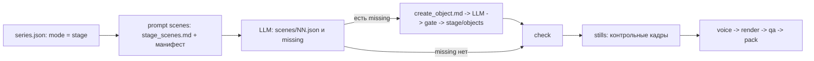

# Автогенератор видео (vg) + пакет stage

Проект для автоматического создания серии коротких роликов: план и сценарии пишет LLM по промптам, озвучка — Silero, иллюстрации рисуются кодом (Pillow + numpy), монтаж и упаковка — ffmpeg. Пакет `stage` добавляет сюжетные сцены: на экране стоят предметы (комната, сервер, облако, замок, линии связи), которые появляются, двигаются и меняются точно в такт речи.

## Структура репозитория

```
vg/                     основной пакет автогенератора
  cli.py                точка входа: python -m vg <команда>
  pipeline.py           check -> voice -> stills -> render -> qa -> pack
  series.py, prompt.py  серии, выбор роликов, сборка промптов для LLM
  ills/                 шаблонные иллюстрации (graph, flow, compare, ...)
                        и интеграция сцен stage (ills/stage.py)
  voice/                озвучка (silero и др.)
  gfx.py, frames.py, caption.py, encode.py, timeline.py, qa.py, check.py, ...
stage/                  пакет сюжетных сцен
  core.py               движок: реестр объектов, события по словам, проверка, манифест
  mat.py                холст и материалы (металл, стекло, свет, пол)
  gate.py               «ворота» для новых объектов от LLM (проверка кода и тест-рендер)
  objects/              библиотека объектов (по файлу на объект)
  examples/             сценарии cloud_pilot и cloud_vs_local
  demo_cloud.py         демо-прогон сценария без проекта
prompts/                промпты для LLM (plan, scenes, stage_scenes, create_object)
presets/                пресеты (default.json)
examples/single_video/  пример серии из одного ролика
series/neuronets_brief/ пример рабочей серии
docs/                   INSTALL.md, USER_GUIDE.md, CHECKLIST.md, OBJECTS.md
make_map.py             генератор PROJECT_MAP.md (карта проекта по docstring'ам)
PROJECT_MAP.md          сгенерированная карта функций и модулей
README_v.1.1.md         описание архива пакета stage (версия 1.1)
```

## Требования

| что | версия | зачем |
|---|---|---|
| Python | 3.12 | интерпретатор |
| Pillow | 10.1+ | рисование кадров и объектов |
| numpy | 1.26+ | фон и градиенты |
| torch, torchaudio, omegaconf, scipy | актуальные | озвучка Silero |
| ffmpeg, ffprobe | в PATH | сборка видео |

## Установка

```bash
pip install -r requirements.txt        # все зависимости проекта
# или только для пакета stage:
pip install -r requirements-stage.txt
```

Подробности — в [docs/INSTALL.md](docs/INSTALL.md).

## Быстрый старт

```bash
# 1. Создать серию
python -m vg new my_series --count 5 --brief "О чём серия"

# 2. Получить промпты, скормить их LLM, положить результат в plan.json / scenes/NN.json
python -m vg prompt plan   my_series
python -m vg prompt scenes my_series 01

# 3. Проверка и полный конвейер
python -m vg check   my_series
python -m vg stills  my_series        # контрольные кадры
python -m vg all     my_series        # voice -> render -> qa -> pack
python -m vg status  my_series
```

Демо сцен stage без запуска всего проекта:

```bash
python -m stage.demo_cloud cloud_pilot   # появятся cloud_pilot.mp4 и cloud_pilot_sheet.png
```

Готовый пример серии из одного ролика — в [examples/single_video/README.md](examples/single_video/README.md), пошаговый план новой серии — в [docs/CHECKLIST.md](docs/CHECKLIST.md).

## Команды CLI (`python -m vg`)

| команда | что делает |
|---|---|
| `new СЕРИЯ [--count N] [--lang ru] [--brief ТЕКСТ]` | создать каркас серии |
| `prompt plan\|scenes СЕРИЯ [ID] [--out ФАЙЛ]` | собрать промпт для LLM |
| `check СЕРИЯ [ID]` | проверить сценарии |
| `voice СЕРИЯ [ID] [--force] [--only]` | озвучка |
| `stills СЕРИЯ [ID]` | контрольные кадры иллюстраций |
| `render СЕРИЯ [ID]` | рендер видео |
| `qa СЕРИЯ [ID]` | контроль качества |
| `pack СЕРИЯ` | упаковка готовых роликов |
| `status СЕРИЯ` | состояние серии |
| `all СЕРИЯ [ID]` | check → voice → render → qa → pack |

## Как это работает



Режим `"mode": "stage"` собирает промпт для LLM вместе с манифестом зарегистрированных объектов. Если нужного объекта нет, LLM пишет его код, `stage/gate.py` проверяет его на безопасность и контракт, вы смотрите превью и одобряете. Библиотека готовых объектов и справочник к ней — в [docs/OBJECTS.md](docs/OBJECTS.md).

## Разработка

- Карта всех модулей и функций проекта автоматически генерируется:
  `python make_map.py` → `PROJECT_MAP.md`.
- История часто используемых команд: `history_commands.txt`.
- Руководство пользователя: [docs/USER_GUIDE.md](docs/USER_GUIDE.md).
