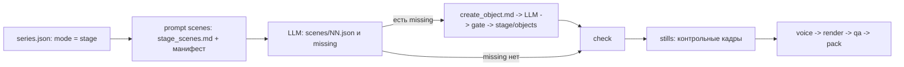

# Автогенератор видео: пакет stage

Добавляет сюжетные ролики: на экране стоят предметы (комната, сервер, облако, замок, линии связи), которые появляются, двигаются и меняются точно в такт речи. Шаблонные иллюстрации проекта (graph, flow, compare и другие) остаются и свободно сочетаются со сценами `stage`.

## Что получаете

- Новый тип иллюстрации `stage`: сцена описывается в JSON (предметы и события по словам текста).
- Библиотека из 10 готовых предметов (все нарисованы кодом, внешних картинок нет) и справочник к ней.
- Режим серии `"mode": "stage"`: промпт для LLM собирается вместе с манифестом предметов.
- Ворота для новых предметов: LLM пишет код, программа проверяет его на безопасность и контракт, вы смотрите превью и одобряете.
- Инструменты установки и проверки, примеры и пошаговые руководства на русском.

## Состав архива

```
vg-stage-pack/
  README.md                  этот файл
  requirements-stage.txt     зависимости пакета (Pillow, numpy)
  docs/
    INSTALL.md               установка и настройка
    USER_GUIDE.md            руководство пользователя
    CHECKLIST.md             чек-лист: новая серия на одной странице
    OBJECTS.md               справочник предметов (создан автоматически)
  stage/                     сам пакет (кладется в корень проекта)
    core.py                  движок: сцена, события, проверка, манифест
    mat.py                   холст и материалы (металл, стекло, свет, пол)
    gate.py                  ворота для новых предметов
    demo_cloud.py            демо-прогон сценария без проекта
    objects/                 библиотека предметов (по файлу на предмет)
    examples/                сценарии cloud_pilot и cloud_vs_local
  overlay/                   обновленные файлы проекта
    vg/                      check, frames, caption, prompt, ills/stage (+ файлы с docstring)
    prompts/                 stage_scenes.md, create_object.md
  examples/single_video/     пример серии из одного ролика
  tools/
    apply_overlay.py         установщик в проект
    verify_install.py        проверка установки
```

## Как это работает



## Быстрый старт

1. Распакуйте архив и поставьте зависимости: `pip install -r requirements-stage.txt`.
2. Проверьте архив: `python tools/verify_install.py .`
3. Посмотрите демо (нужен ffmpeg для mp4): `python -m stage.demo_cloud cloud_pilot`. Рядом появятся `cloud_pilot.mp4` и `cloud_pilot_sheet.png`.
4. Установите в проект: `python tools/apply_overlay.py ПУТЬ_К_ПРОЕКТУ --dry-run`, затем без `--dry-run`.
5. Проверьте установку: `python tools/verify_install.py ПУТЬ_К_ПРОЕКТУ`.
6. Создайте серию по `docs/CHECKLIST.md` или повторите пример `examples/single_video`.

## Требования

Python 3.12, Pillow 10.1 и выше, numpy, ffmpeg и ffprobe в PATH. Остальное (Silero, torch и т.д.) нужно основному проекту, как раньше.

## Чего в архиве нет

Исходного кода основного проекта (`vg/cli.py`, `pipeline.py`, озвучка и др.): архив ставится поверх вашего проекта. Файлы `overlay/vg/*` построены на версиях, которые мне присылали; установщик перед заменой делает копии `.bak`. Если вы меняли эти файлы после отправки, сравните вручную.

## Документация

- Установка: `docs/INSTALL.md`
- Руководство пользователя: `docs/USER_GUIDE.md`
- Чек-лист новой серии: `docs/CHECKLIST.md`
- Справочник предметов: `docs/OBJECTS.md`
