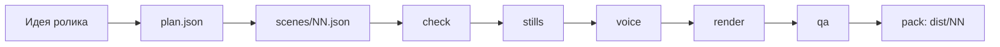
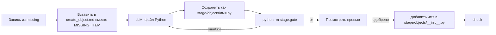

# Руководство пользователя

## 1. Основные понятия

- **Серия**: папка `series/<имя>/` с планом и сценариями роликов.
- **Сцена**: один блок ролика (одна-две фразы озвучки и картинка под них).
- **Иллюстрация (ill)**: что рисуется в сцене. Шаблонные (`intro`, `outro`, `graph`, `flow`, `compare`, `tree` и др.) и новая `stage`.
- **Сцена stage**: постановка из предметов. Предметы стоят на сцене, а события меняют их по ходу речи.
- **Предмет (объект)**: готовый нарисованный элемент библиотеки: `room`, `rack`, `cloud`, `link` и т.д. Список и параметры: `docs/OBJECTS.md`.
- **Событие**: строка "когда слово X произнесено, предмет Y меняет параметр Z".
- **continue**: сцена stage продолжает предметы предыдущей сцены stage в том состоянии, в котором они остались.
- **Манифест**: текстовое описание библиотеки предметов, которое автоматически вставляется в промпт для LLM.
- **missing**: список новых предметов, которые LLM придумала и которых еще нет в библиотеке.



## 2. Формат сцены stage

Сцена stage это обычная сцена документа (поля `key`, `ill`, `title`, `tag`, `color`, `text`, `tts_text`) с `"ill": "stage"` и полем `ill_params`:

```json
{
  "key": "local_server",
  "ill": "stage",
  "title": "СВОЙ СЕРВЕР В ОФИСЕ",
  "tag": "все под вашим контролем",
  "color": [77, 163, 255],
  "text": "Свой сервер стоит в вашем офисе. Вы сами его покупаете...",
  "tts_text": "Свой сервер стоит в вашем офисе. Вы сами его покупаете...",
  "ill_params": {
    "theme": "blue",
    "floor": 780,
    "objects": [
      {"id": "rm", "type": "room", "at": [200, 630], "params": {"alpha": 0, "label": "офис"}},
      {"id": "sv", "type": "rack", "at": [165, 640], "params": {"alpha": 0}}
    ],
    "events": [
      {"word": "Свой", "obj": "rm", "set": {"alpha": 1}, "dur": 0.6, "ease": "ease_out"},
      {"word": "сервер", "obj": "sv", "set": {"alpha": 1}, "dur": 0.6}
    ]
  }
}
```

### Поля ill_params

| поле | обязательно | смысл |
|---|---|---|
| `theme` | нет | цвет предметов: cyan, violet, amber, green, rose, blue (по умолчанию cyan) |
| `floor` | в первой сцене группы | линия пола по вертикали, обычно 780 |
| `continue` | нет | `true`: продолжить предметы предыдущей сцены stage |
| `objects` | да (в первой сцене группы) | новые предметы сцены |
| `events` | нет | изменения во времени |

### Предмет (`objects[]`)

| поле | смысл |
|---|---|
| `id` | имя для ссылок: строчные латинские буквы, цифры, `_`, до 24 символов |
| `type` | тип из библиотеки (`docs/OBJECTS.md`) |
| `at` | центр предмета `[x, y]` на холсте 540 на 960 (для `link` не нужен) |
| `params` | начальные значения параметров |
| `z` | порядок наложения, меньше значит ниже (связям ставят `-1`) |

Общие параметры каждого предмета: `x`, `y`, `alpha` (прозрачность), `scale`, `glow` (свечение), `theme`. Предмет, который должен появиться позже, объявляйте с `"alpha": 0`.

### Событие (`events[]`)

| поле | смысл |
|---|---|
| `word` | начало слова из `text` этой сцены (достаточно 4-6 букв); регистр и знаки препинания не важны |
| `nth` | какое по счету вхождение слова (по умолчанию 1) |
| `idx` или `t` | вместо `word`: номер слова или время в секундах от начала сцены |
| `after` | сдвиг во времени, секунды |
| `obj` | `id` предмета |
| `set` | что меняем: `{"параметр": значение}` (можно несколько) |
| `dur` | длительность перехода, секунды (0 мгновенно; для текста, режима и да/нет смена всегда мгновенная) |
| `ease` | кривая: `smooth` (по умолчанию), `ease_out`, `ease_in`, `linear` |

Менять событием можно только параметры, помеченные "меняется событием" в `docs/OBJECTS.md`.

### Связи

Предмет `link` соединяет две точки привязки: `"from": "lap.bottom", "to": "r1.top"`. Линия невидима, пока событие не поднимет `progress` до 1; бегущие пакеты включает `flow`. Связи ставят `"z": -1`, чтобы линия шла под предметами.

### Раскладка кадра

- Холст 540 на 960, пол на `floor` (780). Предмет на полу стоит низом на этой линии.
- Верхние 100 и нижние 130 единиц не занимайте важным: там интерфейс площадки и субтитры.
- Предметы не должны перекрываться. Главным предметам задавайте `scale` 1.3-1.5.
- Подписи (`badge`, `label`) делайте короткими: до 16 символов.

### Сочетание с шаблонами

Первая сцена всегда `intro`, последняя `outro` (правило проекта). Между ними сцены stage чередуйте с шаблонными (`compare`, `graph` и др.). После шаблонной сцены `continue` не используется: следующая сцена stage объявляет предметы заново и снова задает `floor`.

## 3. Режим серии stage

В `series/<имя>/series.json` добавьте `"mode": "stage"`. Тогда команда `python -m vg prompt scenes ...` соберет промпт из `prompts/stage_scenes.md` и вставит манифест предметов. Без этого ключа работает обычный `scenes.md`.

## 4. Чек-лист: создание новой серии

Подробная версия. Краткая лежит в `docs/CHECKLIST.md`.

**Подготовка (один раз)**

- [ ] Пакет установлен, `python tools/verify_install.py ПУТЬ_К_ПРОЕКТУ` показывает только `[ OK ]`.
- [ ] Шрифты Inter лежат в `assets/fonts/otf/` (как в основном проекте).

**Серия**

1. [ ] Создайте серию: `python -m vg new <имя> --count N --brief "описание серии"`.
2. [ ] Откройте `series/<имя>/series.json` и добавьте `"mode": "stage"` (и при желании `style_over` из `examples/single_video/series_stage_fields.json`).
3. [ ] Составьте `plan.json`:
   - через LLM: `python -m vg prompt plan <имя> --out plan_prompt.md`, ответ сохраните как `series/<имя>/plan.json`;
   - или вручную по образцу `examples/single_video/plan.json` (для одного ролика проще вручную).
4. [ ] Проверьте и поправьте план (id по порядку: 01, 02, ...).

**Для каждого ролика (id = 01, 02, ...)**

5. [ ] Соберите промпт: `python -m vg prompt scenes <имя> 01 --out p.md`.
6. [ ] Отправьте `p.md` в LLM. Ответ сохраните как `series/<имя>/scenes/01.json` (чистый JSON без текста вокруг).
7. [ ] Если в ответе есть `missing` (новые предметы), выполните раздел 6 этого руководства для каждого предмета. Без этого `check` не пройдет.
8. [ ] `python -m vg status <имя>`: ролик должен числиться как "сценарий есть".
9. [ ] `python -m vg check <имя> 01` и исправьте все ошибки (таблица в разделе 8). Предупреждения прочитайте.
10. [ ] `python -m vg stills <имя> 01`: откройте `series/<имя>/out/01/stills/sheet.png`. Проверьте, что предметы не перекрываются, подписи читаются, субтитры не закрывают картинку. Правьте JSON и повторяйте шаги 9-10.
11. [ ] `python -m vg all <имя> 01` (проверка, озвучка, рендер, контроль качества, упаковка).
12. [ ] Посмотрите `series/<имя>/dist/01/`: видео, тексты, субтитры.
13. [ ] Повторите шаги 5-12 для остальных роликов.

**Если что-то изменили после озвучки**

- Текст сцены изменен: перезапустите `python -m vg voice <имя> 01` (повторный синтез только при смене текста).
- Изменены только предметы и события: озвучку трогать не нужно, достаточно `render`.
- Озвучка устарела: рендер остановится с сообщением, это нормально.

## 5. Пример: один ролик от начала до конца

Папка `examples/single_video/` содержит готовую серию из одного ролика "Облако или локальный сервер" (7 сцен: заставка, четыре сцены stage, одна сцена-сравнение, концовка). Все предметы из встроенной библиотеки, новых создавать не нужно.

```
python -m vg new cloud_vs_local --count 1 --brief "Облако или локальный сервер: что выбрать"
```

Дальше:

1. Скопируйте `examples/single_video/plan.json` в `series/cloud_vs_local/plan.json`.
2. В `series/cloud_vs_local/series.json` добавьте `"mode": "stage"` (остальные поля оставьте как создала команда `new`).
3. Положите готовый сценарий: `examples/single_video/scenes/01.json` в `series/cloud_vs_local/scenes/01.json`. (Чтобы пройти путь через LLM, выполните `python -m vg prompt scenes cloud_vs_local 01 --out p.md`, отправьте файл в LLM и сохраните ответ.)
4. `python -m vg status cloud_vs_local` покажет, что сценарий есть.
5. `python -m vg check cloud_vs_local` должен закончиться без ошибок.
6. `python -m vg stills cloud_vs_local`, откройте `series/cloud_vs_local/out/01/stills/sheet.png`.
7. `python -m vg all cloud_vs_local`. Готовое в `series/cloud_vs_local/dist/01/`.

Ролик идет около минуты. Если контроль качества ругается на длительность, увеличьте `max_dur` в `series.json`.

Что показывает пример, на что смотреть в `scenes/01.json`:

- сцена `local_server`: появление комнаты и стойки по словам "Свой" и "сервер", замок закрывается на слове "комнаты";
- сцена `overload`: `"continue": true`, комната и стойка остаются, добавляются телефоны и индикатор нагрузки;
- сцена `compare`: шаблонная вставка между сценами stage;
- сцена `cloud_scale`: после шаблонной вставки без `continue`, поэтому снова `floor` и все предметы объявлены заново;
- сцена `power_cut`: вилка выдергивается на слове "пропадет".

## 6. Новый предмет: создание по описанию

Когда нужен предмет, которого нет в библиотеке (LLM указала его в `missing` или вы придумали сами):



1. Откройте `prompts/create_object.md`. Замените строку `{MISSING_ITEM}` целиком (вместе со скобками) записью из `missing`:
   ```
   {
     "name": "tool_kit",
     "purpose": "показать обслуживание своего сервера",
     "look": "Небольшой металлический чемоданчик с инструментами...",
     "states": "open: число от 0 до 1, плавно открывает крышку",
     "anchors": "top, bottom"
   }
   ```
   В `states` не пишите `alpha`, `x`, `y`, `scale`, `glow`, `theme`: это общие параметры, их задает движок.
2. Отправьте промпт в LLM. Ответ (только код) сохраните как `stage/objects/<name>.py`.
3. Проверьте: `python -m stage.gate stage/objects/<name>.py --preview preview.png`. Должен вернуться пустой список `errors`. Откройте `preview.png`: на нем предмет в разных состояниях.
4. Если есть ошибки или превью не нравится, отправьте LLM ошибки или замечания и повторите.
5. Только после одобрения добавьте имя файла в `stage/objects/__init__.py`, например `from . import room, lock, tool_kit`. (До этого не добавляйте: ворота должны увидеть новый предмет как незарегистрированный.)
6. Повторите `python -m vg check <имя>`.

Ворота проверяют: запрещенные импорты и вызовы (файлы, сеть, `exec` и т.д.), контракт (имя, описание, размер, параметры, точки привязки), тест-рендер с крайними значениями параметров (не дольше 0.5 с на кадр). Они не оценивают красоту: это решаете вы по превью.

## 7. Настройки и команды

Поля `series.json`: `lang`, `style`, `style_over`, `engine`, `voice`, `rate`, `count`, `max_dur`, `brief`, и новое `mode`.

| команда | что делает |
|---|---|
| `python -m vg new <имя> --count N --brief "..."` | создать серию |
| `python -m vg prompt plan <имя> --out файл` | промпт плана |
| `python -m vg prompt scenes <имя> <id> --out файл` | промпт сцен ролика |
| `python -m vg status <имя>` | что готово |
| `python -m vg check <имя> [id]` | проверка сценариев |
| `python -m vg stills <имя> [id]` | контрольные кадры без озвучки |
| `python -m vg voice <имя> [id] [--force] [--only ключ]` | озвучка |
| `python -m vg render <имя> [id]` | сборка видео |
| `python -m vg qa <имя> [id]` | контроль готовых mp4 |
| `python -m vg pack <имя>` | упаковка для публикации |
| `python -m vg all <имя> [id]` | весь конвейер |
| `python -m stage.demo_cloud [сценарий]` | демо без проекта |
| `python -m stage.gate файл.py --preview p.png` | ворота для нового предмета |
| `python tools/verify_install.py [путь]` | проверка установки |

## 8. Типичные ошибки

Ошибки `check` для сцен stage начинаются с `stage:`.

| сообщение | причина | решение |
|---|---|---|
| `objects[N]: неизвестный тип 'x'` | предмета нет в библиотеке или он не подключен | создать предмет (раздел 6) или заменить типом из `OBJECTS.md`; проверить строку в `stage/objects/__init__.py` |
| `objects[N]: нужен at [x, y]` | у предмета нет позиции | добавить `"at": [x, y]` |
| `objects[N]: нет параметра 'p' у type` | выдуманный параметр | взять имя из `OBJECTS.md` |
| `параметр p=v вне допустимого` | значение вне диапазона или не из списка | исправить по `OBJECTS.md` |
| `связь id: from=... не указывает на точку объекта` | неверный `id.точка` или нет такой точки | проверить `id` предмета и список точек привязки |
| `events[N]: нет объекта 'id'` | событие ссылается на неизвестный `id` | исправить `id` или объявить предмет |
| `events[N]: параметр 'p' нельзя менять событием` | параметр фиксированный | менять только параметры с пометкой "меняется событием" |
| `events[N]: слово 'x' ... не найдено в тексте сцены` | слова нет в `text` этой сцены | взять слово из текста сцены, указать `nth` при повторе |
| `id ... уже занят типом ...` | при `continue` id повторен с другим типом | дать новый `id` |
| `floor: число 300..900` | неверное значение пола | поставить около 780 |
| `сцен N, нужно 5-9` | правило проекта | добавить или убрать сцены |
| `intro должен быть ровно один и стоять первым` | правило проекта | первая сцена `intro`, последняя `outro` |
| `title должен быть капсом` или длиннее 22 символов | правило проекта | сократить, писать заглавными |
| сообщение про букву е с двумя точками в поле | правило проекта | заменить ее на обычную `е` |

Ошибки ворот (`stage.gate`):

| сообщение | решение |
|---|---|
| `запрещенный импорт ...` / `запрещенный вызов ...` | попросить LLM убрать: разрешены только `math`, `random` и импорты `core`, `mat` из шаблона |
| `файл должен регистрировать ровно один объект` | в файле один `@obj`; имя не должно совпадать с уже подключенным предметом (не добавляйте в `__init__.py` до проверки) |
| `кадр дольше 0.5 с на k=1` | попросить LLM упростить рисование (меньше размытий) |
| `параметр ...: нужны lo, hi и default внутри` | у числового параметра должны быть границы и значение по умолчанию внутри них |

Прочее: если субтитры закрывают предметы, измените `cap.base_y_stage` или сдвиньте предметы выше; если предметы выглядят мелко, задайте `scale` 1.3-1.5.

## 9. Карта проекта

В файлах пакета у каждого модуля, класса и функции есть docstring: первая строка это краткое назначение. Скрипт `make_map.py` (из корня проекта) строит по ним `PROJECT_MAP.md`. После добавления предметов или правок запустите его заново.

Справочник предметов обновляется командой (из корня проекта):

```
python -c "import stage; print(stage.manifest_text())"
```

Эта команда печатает тот же манифест, который попадает в промпт LLM. Файл `docs/OBJECTS.md` в архиве создан при сборке и после добавления ваших предметов не обновляется сам.
